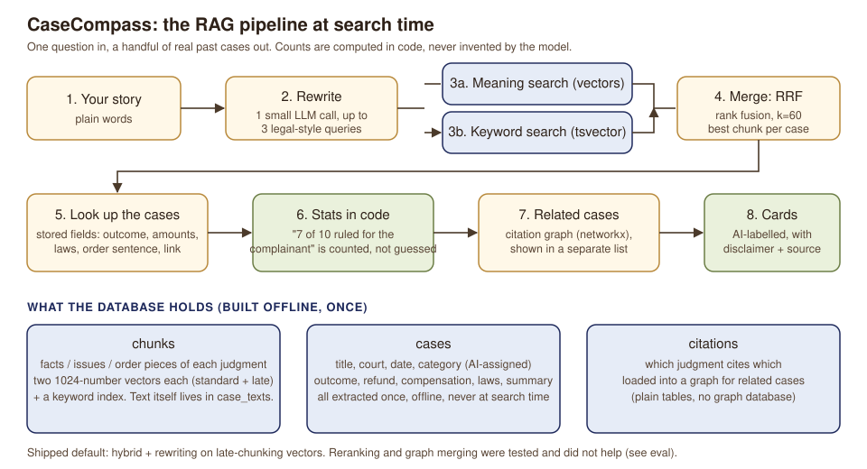
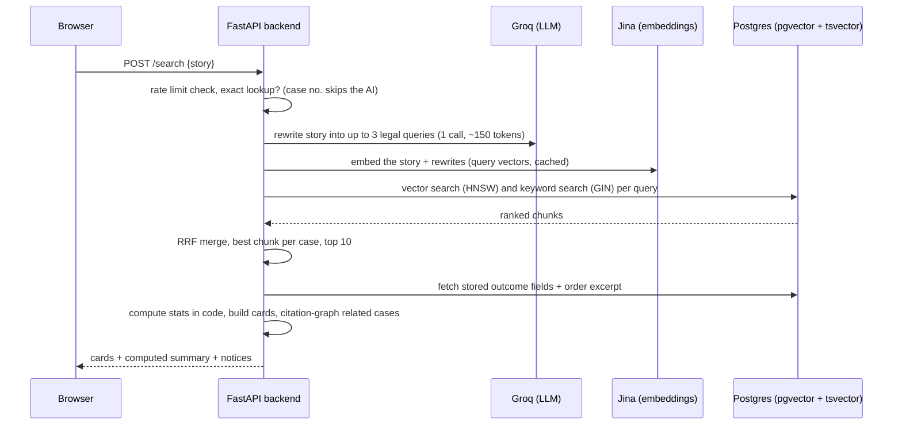
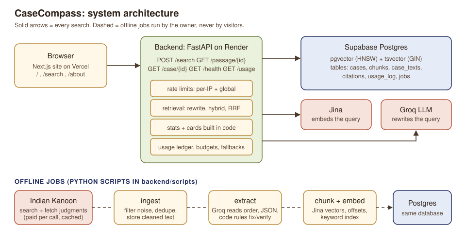
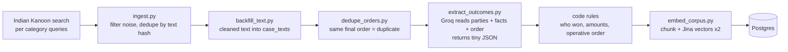

# CaseCompass

**Describe a consumer dispute in plain words and see how Indian consumer commissions decided similar cases.**

Live site: https://case-compass-zeta.vercel.app  |  API: https://casecompass-qw3v.onrender.com/health

CaseCompass searches past NCDRC and state-commission judgments. For each similar case it shows who won,
the refund and compensation, the laws cited, the verbatim sentence of the final order, and a link to the
full judgment. It started with airline and travel refunds and now also covers insurance, builders and
property, medical negligence, banking, defective goods and vehicles, education, telecom and utilities,
and online shopping.

> **It never predicts your result.** It only shows what similar cases decided.
> *This is information, not legal advice. Outcomes are AI-generated from public records and may contain errors.*

This is a portfolio project about **retrieval-augmented generation (RAG)**. The retrieval pipeline,
the honest evaluation numbers and the backend design matter more than the interface.

---

## 1. RAG in plain words

Imagine a very fast law-library assistant with three jobs.

1. **Understand you.** You write "they kept my money for months". Judgments say "deficiency in service,
   refund withheld". One small AI call rewrites your story into up to three queries in the language
   judgments actually use.
2. **Find the right pages.** Two searches run at once. *Meaning search* turns text into numbers (vectors) so
   paragraphs that mean the same thing land close together, even with different words. *Keyword search* catches
   exact things like "Section 14" or a company name. A simple voting rule (Reciprocal Rank Fusion, RRF)
   merges the two ranked lists, so cases that score well on both rise to the top.
3. **Answer without making things up.** Every case was read once, offline, by an AI that filled in a small
   form (outcome, amounts, laws). When you search, **no AI writes the answer**: the app looks up those stored
   fields, counts the outcomes *in code* ("7 of 10 ruled for the complainant"), and quotes the judgment's own
   words. The AI never invents a number at search time.



### What happens on one search, step by step



If a service is down the app degrades instead of failing: Jina out gives keyword-only search with a notice;
the LLM out means no rewriting (still works); Indian Kanoon out only removes the "why this result" passage.

---

## 2. System architecture



| Part | What it is | Where it runs |
|---|---|---|
| Frontend | Next.js (App Router), TypeScript, Tailwind. `/` landing story, `/search` tool, `/about` | Vercel |
| Backend | FastAPI + Pydantic, async httpx. Search, passage, case, health, usage endpoints | Render (free, Docker) |
| Database | Supabase Postgres with pgvector (HNSW) and tsvector (GIN) | Supabase |
| Embeddings | Jina `jina-embeddings-v3`, 1024 dims, query vs passage task types | Jina API |
| LLM | Groq `gpt-oss` models behind a small `LLMProvider` interface, small-then-large cascade | Groq API |
| Source data | Indian Kanoon API (paid per call, every response cached on disk) | offline scripts only |

The backend never calls Indian Kanoon during a search. Everything a search needs is already in the database.

---

## 3. The offline pipeline (how the data gets in)



1. **Discover and ingest.** Keyword searches per category (`doctypes=consumer`) find candidates; code drops
   non-commission results and obvious noise *before* paying to fetch a judgment. Duplicates are removed by text
   hash and by identical final orders. Fetching is balanced round-robin across categories.
2. **Extract.** A small model reads only the parties header, the opening facts and the final order (never the
   whole judgment, capped near 4,000 tokens) and returns JSON: result (`allowed`, `partly_allowed`,
   `dismissed`, `unclear`), refund, compensation, category, one-line summary. Pydantic validates it. Unsure or invalid
   answers **escalate to the larger model**; amounts the model reports must literally appear in the text or they
   are dropped.
3. **Code rules after the model.** The model's weak spot is "who appealed?", so code reads the final order too:
   "complaint dismissed", "partly allowed", "airline's appeal dismissed so the award stands". A parser reads
   amounts like "Rs. 2 lakhs", and `operative_order()` copies the last operative sentences verbatim for the card.
4. **Chunk and embed.** Judgments are cut into structured chunks (facts, issues, order), each prefixed with a
   context line (case title, court, year, category). Jina embeds each chunk twice: normally, and with **late chunking**
   (the whole document is embedded in one pass first, so each chunk "remembers" its surroundings). Corpus embedding is
   an offline script; at runtime only the query is embedded.

---

## 4. Backend guide

```
backend/
  app/
    api/main.py          FastAPI app: endpoints, rate limits, client-IP handling, CORS
    retrieval/search.py  dense + keyword search, RRF merge, case collapsing
    retrieval/pipeline.py  the full search: rewrite, merge, enrich, stats, notices
    llm/                 provider (Groq via openai SDK), cascade (small then large), rewrite prompt
    embeddings/jina.py   embedder interface + Jina client, query-vector cache
    rerank/              reranker interface (optional, off by default)
    extraction/extract.py  LLM extraction + code rules (rule_override, amounts, operative order)
    chunking/chunker.py  structural chunks + context line
    graph/               citation graph (networkx) for related cases
    textstore.py         where judgment text comes from (our database first)
    usage/ledger.py      every LLM and Jina call logged; budgets and pool tracking
    db/                  connection with retry (the free pooler drops connections)
  scripts/               ingest, backfill_text, extract_outcomes, embed_corpus, dedupe_orders, migrate ...
  migrations/            001-006 SQL, tracked in a schema_migrations table
  tests/                 API safety, pipeline, retrieval regression
```

**Endpoints**

| Endpoint | What it does |
|---|---|
| `POST /search` | `{story, mode, top}`; returns summary, cards, rewritten queries, related cases, notices |
| `GET /passage/{tid}?start&end` | the matched passage for "Why this result" (range limited to 3,000 characters) |
| `GET /case/{tid}` | case metadata only (never judgment text) |
| `GET /health`, `GET /usage` | liveness and spend ledger |

**Database tables:** `cases` (metadata, category, extracted outcome fields), `chunks` (offsets, two vectors, tsvector),
`case_texts` (cleaned judgment text), `citations` (edges), `usage_log`, `jobs`, `schema_migrations`. Row-level
security is on for every table and Supabase's public API roles have no privileges.

**Cost and safety controls (all in code)**
- Per-IP rate limit (10 searches a minute), 30 a minute on passage/case, and a global cap of 60 searches a minute.
  The client IP is taken only from the proxy-added header, so a forged header cannot bypass it.
- Hard cap of 3 LLM calls per request, a daily token budget with a hard stop, and a usage ledger
  (tokens in/out, estimated cost, stage).
- Jina free pool (10M tokens) tracked: warning at 70%, hard stop at 90%, then keyword-only fallback.
- Search makes **zero** Indian Kanoon calls. The production spend cap is 0 INR.
- Responses from the LLM, embeddings and Indian Kanoon are cached by hash.
- Product rules: never "you will win", the disclaimer is always shown, AI outputs are labelled, counts are computed in code.

---

## 5. Evaluation (honest numbers)

**Retrieval**: 27 plain-language airline stories, relevance by dispute-type tags, searching the airline category
(measured on the 424-case corpus; the corpus later grew to 600+ cases).

| Pipeline | hit@5 | P@5 | MRR | nDCG@10 |
|---|---|---|---|---|
| naive vector search | 0.96 | 0.66 | 0.87 | 0.65 |
| + hybrid (RRF) | 0.96 | 0.67 | 0.89 | 0.63 |
| + Jina rerank (derived text) | 0.96 | 0.65 | 0.87 | 0.59 |
| + query rewriting (no rerank) | 0.96 | 0.66 | 0.91 | 0.62 |
| + citation-graph merge | 0.96 | 0.66 | 0.91 | 0.58 |
| **hybrid + rewriting + late chunking (shipped)** | **1.00** | **0.70** | **0.94** | **0.68** |

What did **not** help, reported honestly: reranking on our derived text was worse than plain hybrid, so it is off;
merging the citation graph into the ranking lowered nDCG, so related cases are shown as a separate list. Late chunking
plus rewriting was best or equal on every metric and is the shipped default. After adding about 400 cases from other
categories the airline numbers stayed flat (new airline cases have no hand labels, which pushes precision down slightly).

**Other categories**: a 16-story check (insurance, medical, property, banking, goods, education, telecom, online shopping)
found the expected dispute type in 70 of 80 top-5 results (88%) and at least one right result in all 16 stories.
Categories are AI-assigned, not human-checked, and online shopping has only a handful of cases. Details: `eval/results_multi.md`.

**Outcome-label accuracy** (checked by Claude against the end of each judgment, not by a human):

| Sample | Condition | Result |
|---|---|---|
| fresh blind sample 2 (n=35) | before the extra rule | 71% (95% interval 55-84%) |
| fresh blind sample 3 (n=27) | rules frozen | **78%** (59-89%) |

The recurring error is **who appealed** (an airline's failed appeal means the complainant won). A prompt that adds the
case header did not clearly help (75% vs 71% on 40 cases), and two title/header-based code rules did not beat the model,
so it remains a known limitation. Amounts are weaker than outcomes. Treat labels as hints and read the order.

Everything is in `eval/` (stories, labels, `run_eval.py`, `run_multi.py`, review results) and `docs/PROJECT_GUIDE.md`.

---

## 6. Data

About 600+ consumer-commission judgments (NCDRC and state commissions, plus a few Supreme Court matters) across ten
categories, with citation edges. Judgment text comes from [Indian Kanoon](https://indiankanoon.org) and is stored cleaned in
Postgres; search and passages need no live source calls. The collection is small for the field. Coverage is thinnest for
online shopping, education and telecom. Total Indian Kanoon spend so far is about 204 INR.

---

## 7. Run it yourself

```bash
cp .env.example .env            # add your own keys (never commit them)
cd backend && python -m venv .venv && .venv/Scripts/pip install -r requirements.txt
PYTHONPATH=. .venv/Scripts/python scripts/migrate.py
PYTHONPATH=. .venv/Scripts/python -m uvicorn app.api.main:app --port 8000
cd ../frontend && npm install && npm run dev      # http://localhost:3000
```

```bash
cd backend && .venv/Scripts/python -m pytest -q            # 30 tests (10 skip without a database)
.venv/Scripts/python -m ruff check .                        # lint
python ../eval/run_eval.py                                  # regenerate eval/results.md
```

Deploy: backend on Render (`render.yaml`, secrets in the dashboard), frontend on Vercel with `NEXT_PUBLIC_API_URL`.
The free backend sleeps when idle, so the site pings `/health` when a page opens and an external monitor keeps it warm.
CI (GitHub Actions) runs lint and tests for the backend and lint plus build for the frontend. Step by step: `docs/DEPLOY.md`.

---

## 8. Limits, in plain words

- The collection is small, and thin in some categories.
- Outcome labels are about 71-78% right by a model reviewer; amounts are weaker. No lawyer reviewed anything.
- Eval labels are coarse and rule-based; 27 stories is a small sample.
- It is a search over past decisions, not advice. Always read the judgment.
- Free-tier hosting: cold starts, in-memory rate limiter (fine for one instance).

## 9. Licence and attribution

Code: MIT (see `LICENSE`). Judgments and citation data come from Indian Kanoon and the issuing commissions and are
provided as-is with no accuracy warranty. The "powered by IKanoon" logo is shown unaltered on the results page.
CaseCompass is independent and is not endorsed by or affiliated with Indian Kanoon. The version on Indian Kanoon and
the issuing commission is the authoritative record.
